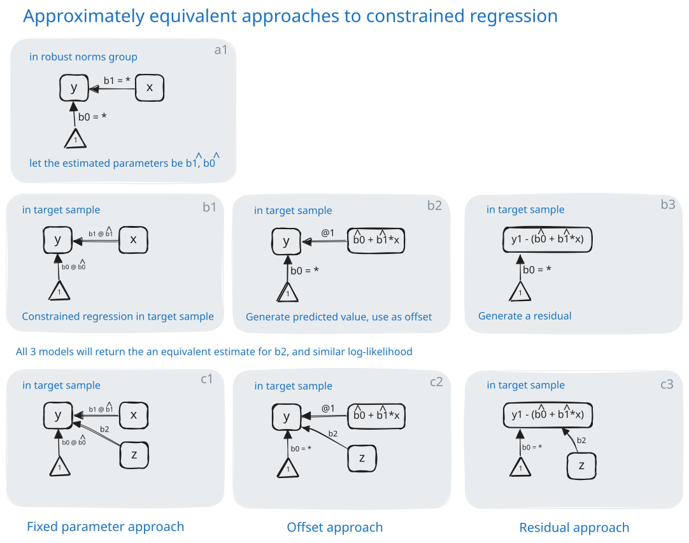

## PMM: covariate adjustment

:::: {.columns}
::: {.column width="58%"}
{width="100%"}
:::

::: {.column width="42%"}

Each cognitive test is regressed on the sociodemographic terms in the HRS/HCAP robust norms group. The coefficients describe expected performance for a person free of conditions that affect cognition, the same norming step as the Manly-Jones algorithm.

Three methods give the same adjustment: a residual from the norms-group equation, an offset, or fixed regression coefficients.

The Manly-Jones algorithm uses residuals. The PMM uses fixed coefficients, because five of the eight core cognitive tests are ordinal (ordered categories), and residuals do not work for ordinal tests.

:::
::::

