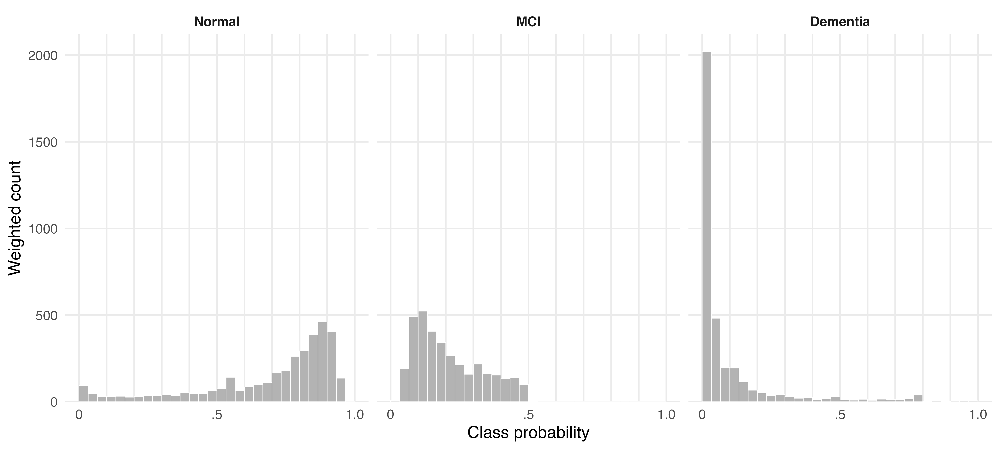

## PMM: class probabilities (2)

{fig-align="center" height="420"}

Each panel shows one class probability for every HRS/HCAP participant (N = `r format(nrow(analysis2_pmm_margins$data$margins_sample), big.mark = ",")`), from the informant model when an IQCODE is present and otherwise from the cognition model. Bar heights are weighted counts: HCAP16WGTR rescaled to sum to the sample size. All panels share one y-axis. 

