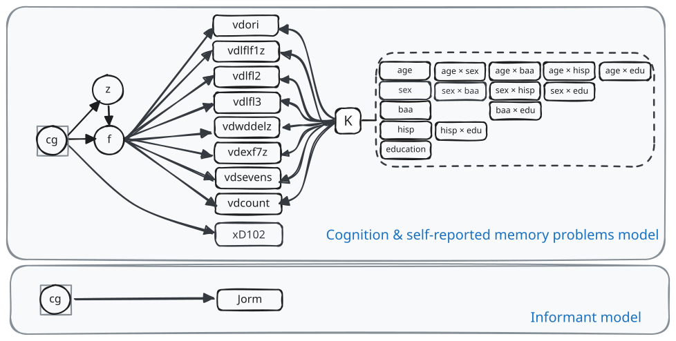

## New approach: profile mixture modeling

- PMM is a mixture-modeling approach that uses the joint pattern of multiple observed indicators to define latent profiles and estimate the probability that each person belongs to each profile.
- In this project, PMM is trained against known HRS/HCAP actuarial classifications, with cognitive indicators adjusted using fixed parameters from the robust norms group, and then applied to HRS Core as a probabilistic classification rule.

## PMM structure

:::: {.columns}
::: {.column width="58%"}
{width="100%"}
:::

::: {.column width="42%"}

The PMM has 2 parts. The cognition model applies to the `r fn(n_cog)` HRS/HCAP participants with at least 1 cognitive test score or a self-rating of memory. The informant model applies to the `r fn(n_inf)` participants with an informant report (Jorm IQCODE) and no test score or self-rating; its only indicator is the IQCODE. Each participant receives probabilities from 1 model (N = `r fn(n_hcap)`).

`cg` is a latent class variable (a known class in the HRS/HCAP calibration sample, and an unknown class in the HRS Core application sample). The classes correspond to normal cognition, MCI/CIND, and dementia.

`GCP` (general cognitive performance) is a factor measured by the 8 cognitive tests. Its mean and variance differ by class (Normal class: mean 0, variance 1). The loadings, intercepts, thresholds, and residual variances of the tests are equal across classes, so the tests inform class only through GCP. The thresholds of self-rated memory differ by class.

`K` is a matrix of fixed regression coefficients used to adjust the tests for sociodemographics. These parameters are estimated in the robust norms sample and then loaded into the classification model: 8 tests $\times$ `r n_cov_terms` sociodemographic terms = `r 8 * n_cov_terms` coefficients. This fixed-parameter regression is equivalent to the approach used by Manly et al (2022) (regression adjustment of cognitive domains using the normative reference group).

Cognitive tests: `vdori`, Orientation to date; `vdlfl1z`, Animal naming; `vdlfl2`, Object naming; `vdlfl3`, President & vice-president; `vdwddelz`, Delayed word recall; `vdexf7z`, Number series; `vdsevens`, Serial sevens; `vdcount`, Count backwards from 20.

:::
::::

## Why a general cognitive factor

- Within each class, people differ in overall cognitive performance, so their test scores correlate. In the robust norms group, the continuous test scores correlate after demographic adjustment.
- A model without the factor sets these within-class correlations to 0. It counts correlated evidence as if it were independent (a low delayed recall score and a low animal naming score each count fully toward impairment), and its probabilities are more extreme than the data justify.
- The factor carries the within-class correlation with 1 set of loadings. The model with the factor fit the data better than the model without it, with fewer parameters.
- An exploratory comparison allowed test intercepts and thresholds to differ by class. That alternative was not adopted. The archived comparison includes a flagged fit and does not rule out the alternative.

## Same inputs as the Core algorithm

- The PMM uses the information the Core algorithm uses, so that differences in agreement with the HRS/HCAP Algorithm reflect the classification method and not access to different data.
- Not included: limitations in activities of daily living (ADL) and instrumental activities of daily living (IADL). The Core items do not say why a limitation is present, and a limitation with a physical cause would raise the probability of dementia (for example, hip arthritis and difficulty dressing).
- Not included: immediate word recall. It adds little beyond delayed recall (Jones et al., 2024) and is not part of the Core algorithm.

## How our approach differs from LDA and QDA

LDA and QDA (Linear and quadratic discriminant analysis, respectively) classify people from the joint distribution of multiple indicators, but they are usually framed for continuous Gaussian variables. In LDA, classes differ in their means, but they are assumed to share the same covariance matrix. In QDA, both the class means and the class-specific covariance matrices are allowed to differ. Our PMM is closer to a generative LDA/QDA family model than to a simple discriminative classifier, because it models the distribution of the indicators within class and then computes posterior class probabilities.

For the cognitive indicators, PMM handles the indicator means through fixed sociodemographic adjustment terms estimated in the robust norms group, plus class differences in the mean and variance of the general cognitive factor. That means expected performance is anchored to the normative reference group rather than re-estimated in the target sample. Because the factor variance differs by class, the implied covariance of the tests also differs by class, a structured form of QDA; the residual variances of the tests are equal across classes. PMM is also more flexible than classical LDA or QDA because several indicators are ordinal or discrete, so class separation is represented through latent-response means, thresholds, and a shared factor rather than only through multivariate Gaussian means and variances on the observed score scale.

## How our approach differs from predictive modeling

Many predictive models are optimized to maximize classification accuracy in the sample at hand, even if that means learning direct associations of sociodemographics with class membership or relying on patterns that are difficult to transport or interpret. Our PMM is built for a different goal: it separates measurement from classification, anchors expected cognitive performance in a normative reference group, and then classifies people according to how their observed indicator pattern departs from that demographically adjusted expectation. In this sense the PMM approach is a measurement model rather than a prediction model.

## How our approach is similar to LDA and machine learning

- Unlike Manly et al (2022), there is no decision tree.
- The PMM takes as input the cognitive tests and self-rated memory (or an informant report), and outputs probabilities of class membership. LDA and machine learning classifiers would do the same.
